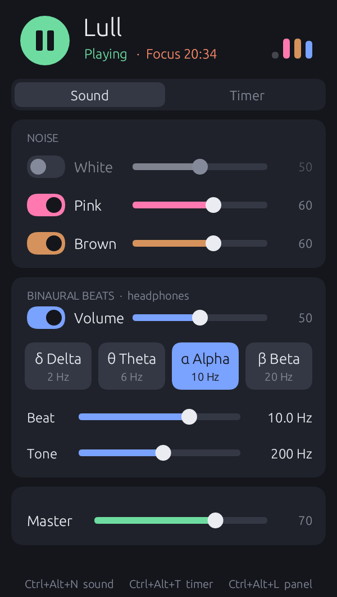
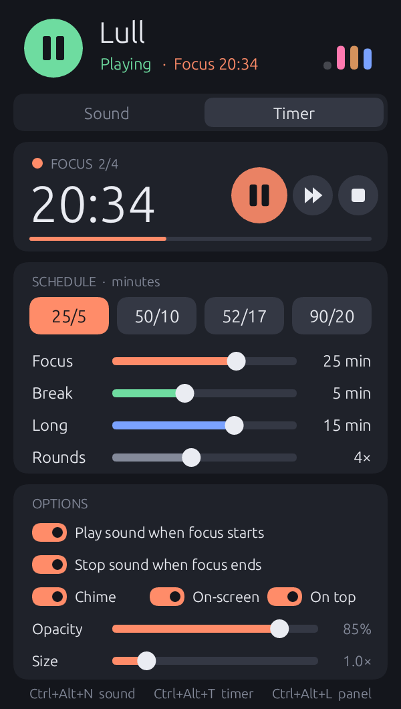
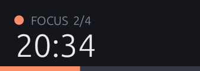

# Lull

ショートカットキー一発で鳴らせる、常駐型の小さなノイズ＆バイノーラルビート生成アプリです。
ポモドーロタイマーも付いています。Windows と macOS で動きます。Rust 製で、待機中のメモリ使用量は約 2 MB です。

 

## ダウンロード

[Releases](https://github.com/shirumono42/lull/releases/latest) から入手してください。

| OS | ファイル | 使い方 |
| --- | --- | --- |
| Windows 10/11 (x64) | `Lull-windows-x64.zip` | 展開して `Lull.exe` を実行 |
| macOS 11+ (Apple Silicon / Intel) | `Lull-macos-universal.zip` | 展開して `Lull.app` を「アプリケーション」へ移動して起動 |

インストーラーはありません。起動するとタスクトレイ（macOS はメニューバー）にアイコンが出ます。

macOS 版は GitHub Actions でビルドとテストを通していますが、実機での動作確認はまだです。
うまく動かない場合は [Issues](https://github.com/shirumono42/lull/issues) で教えてください。

### 新しいバージョンに更新するとき

新しい `Lull.exe` / `Lull.app` をそのまま起動してください。

- 古いバージョンが動いていれば自動で終了し、新しいバージョンに置き換わります（v0.3.0 以降）。
  古いバージョンのトレイアイコンがしばらく残って見えることがありますが、マウスを乗せると消えます。
- 設定は、直前の**音の設定**（各ノイズのオン・オフと音量、バイノーラルビート、マスター音量）だけを引き継ぎ、
  タイマー・画面上のタイマー・ショートカットキーなどは初期値に戻ります。
- 同じバージョンをもう一度起動しても、2 つ目は何もせずに終了します（動いているタイマーや音はそのままです）。

> **macOS で「開発元を確認できない」と表示されたら**: 署名していないためです。
> `Lull.app` を右クリック →「開く」を選ぶか、ターミナルで次を実行してください。
>
> ```bash
> xattr -dr com.apple.quarantine /Applications/Lull.app
> ```
>
> **Windows で SmartScreen が出たら**: 「詳細情報」→「実行」を押してください。

## 使い方

| 操作 | Windows | macOS |
| --- | --- | --- |
| 音の再生 / 停止 | `Ctrl + Alt + N` | `Control + Option + N` |
| タイマーの開始 / 一時停止 | `Ctrl + Alt + T` | `Control + Option + T` |
| パネルを開く / 閉じる | `Ctrl + Alt + L` | `Control + Option + L` |
| パネルを開く | トレイアイコンを左クリック | メニューバーのアイコンをクリック |
| メニュー | トレイアイコンを右クリック | アイコンを右クリック |

右クリックのメニューからは、パネルの表示（Show panel）、音の再生 / 停止（Play sound / Stop sound）、
タイマーの開始・一時停止・再開（Start / Pause / Resume timer）、タイマーのリセット（Reset timer）、
終了（Quit Lull）ができます。

パネルの外をクリックするとパネルは消えますが、音もタイマーも動き続けます。パネル表示中は
`Space` で音の再生 / 停止、`Tab` でタブ切り替え、`Esc` で閉じる、`Q` で終了できます。

### Sound タブ

- **Noise**: ホワイト / ピンク / ブラウンノイズを個別にオン・オフし、音量を調整。複数を同時に重ねられます。
- **Binaural Beats**: オン・オフと音量、プリセット（δ Delta 2 Hz / θ Theta 6 Hz / α Alpha 10 Hz / β Beta 20 Hz）。
  - **Beat**: 左右の周波数差（0.5〜40 Hz）を自由に調整
  - **Tone**: 基準となる音の高さ（60〜600 Hz）
- **Master**: 全体の音量
- スライダーはドラッグのほか、マウスホイールでも動かせます。
- ヘッダー右の色付きバーで、いま鳴っている層がひと目でわかります。

バイノーラルビートは左右の耳に別の周波数を流すため、**ヘッドホン / イヤホンで聴いてください**。

### Timer タブ（ポモドーロ）

集中 → 休憩 → 集中 … と進み、設定した回数の集中が終わると長い休憩に入り、それが終わるとタイマーも止まります。

- **再生 / 一時停止・スキップ・リセット**の 3 ボタン
- **プリセット**: 25/5（長休憩 15 分・4 回）、50/10（30 分・3 回）、52/17（30 分・3 回）、90/20（30 分・2 回）
- **Focus / Break / Long / Rounds**: 集中時間（1〜120 分）、休憩、長い休憩（1〜60 分）、長い休憩までの回数（1〜8）を自由に設定。動作中に変えてもすぐ反映されます。
- **Play sound when focus starts**: 集中が始まると音を鳴らし、タイマーを一時停止すると音も止めます。
- **Stop sound when focus ends**: 集中が終わったとき（タイマー全体の終了時も）に音を止めます。
- **Chime**: 区切りごとに小さなベルを鳴らします。

2 つの音の設定を組み合わせると、たとえば両方オンなら「集中中だけ鳴る」、
下だけオンなら「手動で鳴らした音が集中の終わりで止まる」ようになります。

#### 残り時間の表示

- **Windows**: タスクバーのトレイアイコンが残り分数の数字（集中はオレンジ、休憩は緑、長休憩は青、一時停止中は灰色）に変わります。
  マウスを乗せると秒まで表示されます。

  

  - Windows 11 は新しいアイコンを `^` の中に隠しますが、Lull は自分のアイコンをタスクバーに出す設定にします。
    これは初回起動時と、新しいバージョンに更新したあとの最初の起動時に 1 回だけ行います。
    隠したい場合は、設定 → 個人用設定 → タスクバー →「その他のシステム トレイ アイコン」で Lull をオフにすれば、そのまま保たれます。
  - `Lull.exe` を別のフォルダーに移すと Windows からは別のアプリに見えるため、アイコンは `^` の中に戻ります。
    もう一度出したい場合は、`settings.txt` の `tray_pinned=1` の行を消して起動し直してください。
- **macOS**: メニューバーのアイコンの横に `24:59` のように表示されます。

#### 画面上のタイマー（On-screen）

Timer タブの **On-screen** をオンにすると、タイマー動作中（一時停止中を含む）は画面上に小さなタイマーが出ます。



- ドラッグで好きな位置へ移動、マウスホイールで大きさを変更（パネルの **Size** でも可、0.6〜3 倍）
- ダブルクリックで一時停止 / 再開
- **Opacity** で不透明度（20〜100 %）、**On top** で常に最前面に表示するかを設定
  （On-screen がオフのあいだ、この 2 つと Size は薄く表示されます）
- 位置と大きさは保存され、次回も同じ場所に出ます
- macOS ではすべてのデスクトップ（Space）とフルスクリーンのアプリの上にも表示されます

### 設定の保存場所

設定は自動で保存されます。パネルを閉じたときと終了時のほか、画面上のタイマーを動かしたり大きさを変えたりしたときは、
操作が止まってから 2 秒後に保存されます。

- Windows: `%APPDATA%\lull\settings.txt`
- macOS: `~/Library/Application Support/lull/settings.txt`

同じフォルダーの `instance.txt` は、いま動いている Lull を見分けるためのファイルです（編集する必要はありません）。

### ショートカットキーの変更

他のアプリとキーが重なっている場合、パネル下部に `(in use)` と表示されます。
`settings.txt` の次の行を書き換えて Lull を再起動してください。

```
hotkey_play=ctrl+alt+KeyN
hotkey_timer=ctrl+alt+KeyT
hotkey_panel=ctrl+alt+KeyL
```

修飾キーは `ctrl` `alt`（macOS では Option）`shift` `super`（Windows キー / Command）、
キーは `KeyA`〜`KeyZ`、`Digit0`〜`Digit9`、`F1`〜`F12`、`Space` などが使えます。
書き方が正しくない場合は初期値のキーが使われます。

新しいバージョンに更新すると、ショートカットキーも初期値に戻ります。変更していた場合は、更新後にもう一度書き換えてください。

### ログイン時に自動起動する

- Windows: `Win + R` で `shell:startup` を開き、`Lull.exe` のショートカットを置く
- macOS: システム設定 → 一般 → ログイン項目 に `Lull.app` を追加

## 省メモリの工夫

- パネルと画面上のタイマーは表示中だけ存在し、閉じるとウィンドウ・描画バッファ・フォントをすべて破棄します。
- GPU を使わず、CPU で直接描画します（tiny-skia + ab_glyph）。フォントは埋め込みデータを直接参照し、使う文字だけを描画します。
- 停止中はオーディオデバイスを解放します。止めるときは短くフェードアウトしてから解放します。
- 音声処理はロックなし（atomic）で、コールバック内でメモリを確保しません。

Windows 11 で計測した値（Private Bytes）は次のとおりです。

| 状態 | メモリ |
| --- | --- |
| 待機中（パネル非表示・停止） | 約 1.8 MB |
| 再生中（パネル非表示） | 約 4.4 MB |
| タイマー＋画面上タイマー表示中 | 約 3.0 MB |
| タイマー＋画面上タイマー＋パネル表示中 | 約 6.0 MB |

## ソースからビルド

[Rust](https://rustup.rs/) をインストールしてから実行します。

```bash
cargo build --release
```

実行ファイルは `target/release/lull`（Windows は `lull.exe`）に出力されます。

## 技術メモ

- ノイズ: ホワイトは xorshift64* 乱数、ピンクは Paul Kellet のフィルタ、ブラウンはリーク付き積分。左右は独立に生成するので広がりのある音になります。
- バイノーラル: 左 `Tone − Beat/2`、右 `Tone + Beat/2` の正弦波。
- チャイム: 784 Hz と 1176 Hz の 2 つの正弦波を約 2 秒で減衰させたベル音。音を止めていても鳴ります。
- 音量の変化はサンプル単位でなめらかにしているので、操作してもプチッというノイズが出ません。
- 音が大きくなりすぎたときは、割れないようにゆるやかに抑えます（ソフトリミッター）。
  計算結果に異常な値が出た場合は音の生成をリセットし、その音が鳴り続けないようにしています。
- 最終段に 20 Hz のハイパスフィルタを入れています。ピンク / ブラウンノイズは耳に聞こえない超低域を多く含み、
  そのせいで信号レベルが短時間に ±2 dB ほど揺れます。OS のラウドネス補正やヘッドホンのリミッターがこれに反応して
  音量が勝手に上下して聞こえるため、超低域を取り除いています。
- Windows では、通話アプリの使用中に他の音を下げる機能（ダッキング）の対象から Lull を外しています。
- 起動時に、ほかに動いている Lull を実行ファイル名で探します。違うバージョンなら終了させ、同じバージョンなら自分が終了します。
- パネルと画面上のタイマーは、表示内容が変わったときだけ描き直します。

## License

MIT
